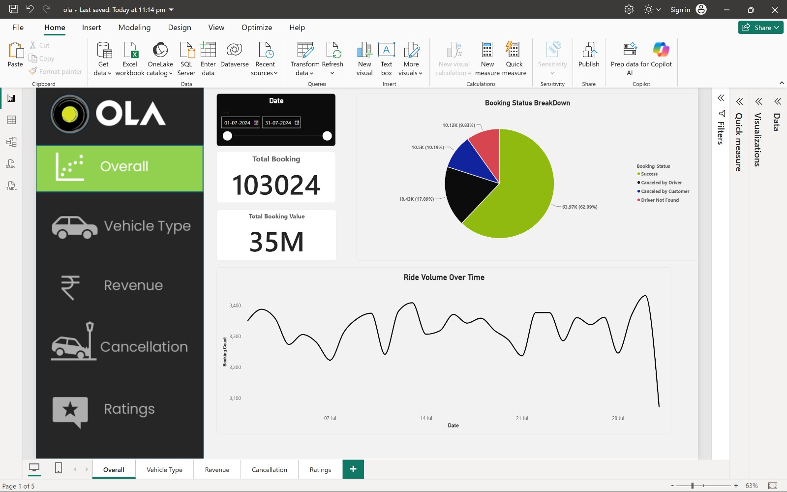
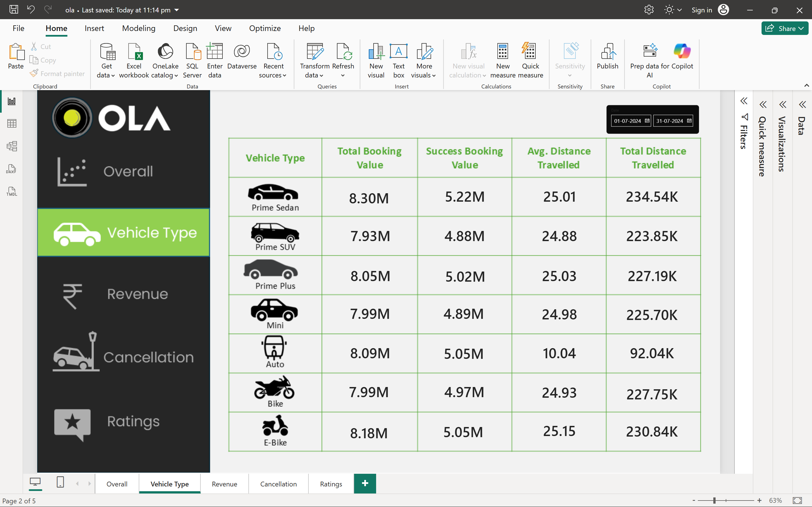
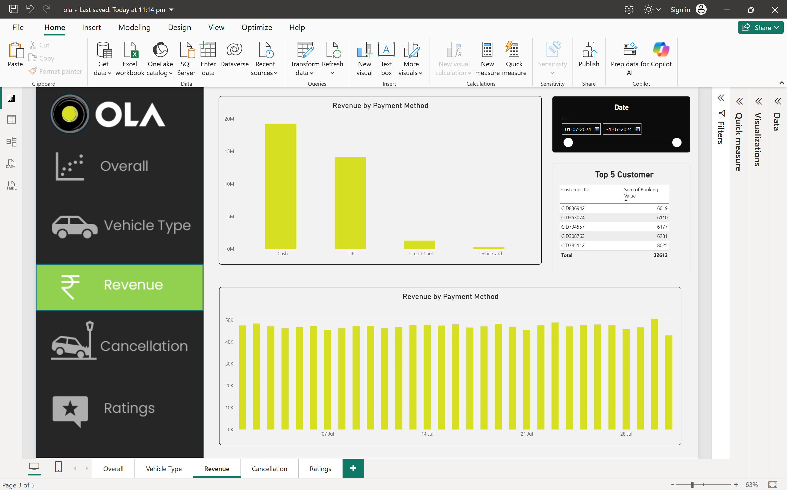
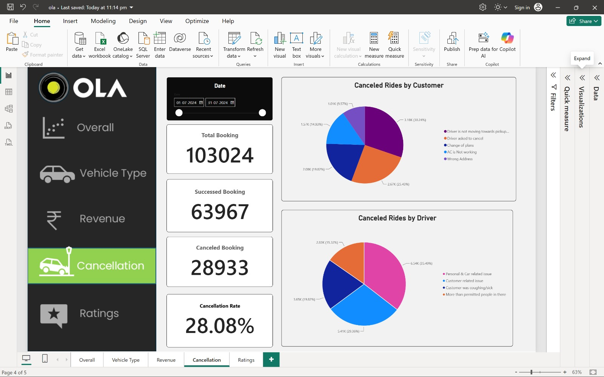
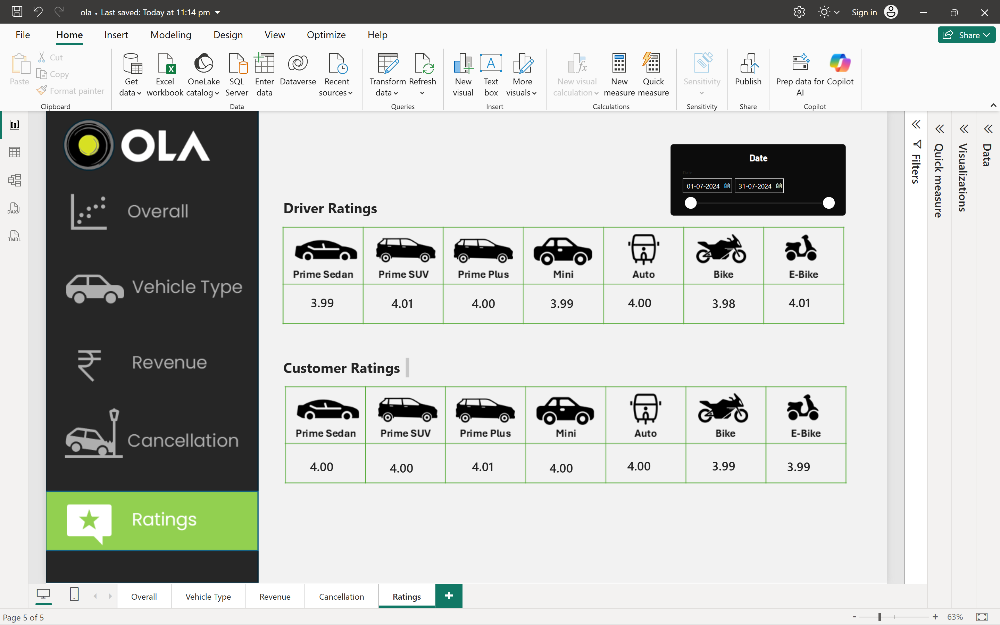

# OLA Ride Booking Analysis

Analysed **103,024 OLA ride bookings (July 2024)** using **MySQL** and **Power BI** to understand cancellations, revenue, vehicle-type performance and customer/driver ratings.

## Tools

- MySQL (views, aggregate queries)
- Power BI (5-page interactive dashboard, DAX measures)

## Dashboard Preview

| Overall | Vehicle Type |
|---|---|
|  |  |

| Revenue | Cancellation |
|---|---|
|  |  |

| Ratings |
|---|
|  |

## Key Insights (July 2024)

- **103,024 bookings**, of which **63,967 (62.09%) were successful**, worth about **35M**.
- **28.08% cancellation rate** (28,933 cancelled rides): 18.43K cancelled by drivers and 10.5K by customers. Another 10.12K bookings ended with "Driver Not Found".
- **Top customer cancellation reason:** driver not moving towards pickup (30.24%), followed by the driver asking to cancel (25.43%).
- **Top driver cancellation reason:** personal and car-related issues (35.49%), then customer-related issues (29.36%).
- **Payments:** Cash (~19M) and UPI (~14M) make up almost all revenue. Card payments are small.
- **Vehicle types:** Prime Sedan has the highest successful booking value (5.22M). Auto trips are much shorter (avg ~10 km) than other types (avg ~25 km).
- **Ratings:** driver and customer ratings are about 4.0 across all vehicle types.

## Dataset

- Source: _add dataset link here (e.g. Kaggle)_
- Period: 01-07-2024 to 31-07-2024
- Main columns: `Date`, `Time`, `Booking_ID`, `Booking_Status`, `Customer_ID`, `Vehicle_Type`, `Pickup_Location`, `Drop_Location`, `V_TAT`, `C_TAT`, `Canceled_Rides_by_Customer`, `Canceled_Rides_by_Driver`, `Incomplete_Rides`, `Incomplete_Rides_Reason`, `Booking_Value`, `Payment_Method`, `Ride_Distance`, `Driver_Ratings`, `Customer_Rating`

## SQL Analysis

`sql/ola.sql` creates the `OLA` database, runs data quality checks, and builds 15 views (10 basic and 5 advanced using CTEs and window functions). The basic views answer:

1. Which bookings were successful?
2. What is the average ride distance by vehicle type?
3. How many rides were cancelled by customers?
4. Which customers booked the most rides?
5. How many rides were cancelled by drivers for personal or car-related issues?
6. What are the maximum and minimum driver ratings for Prime Sedan?
7. Which rides used UPI?
8. What is the average customer rating by vehicle type?
9. What is the total booking value of successful rides?
10. What are the reasons for incomplete rides?

The advanced views cover cancellation rate by vehicle type, top customers by spend (with `RANK()`), daily bookings with a 7-day moving average, revenue share by payment method, and customer cancellation reasons.

## Power BI Dashboard

Five pages: **Overall, Vehicle Type, Revenue, Cancellation, Ratings**, with a date slicer on each page.

Custom DAX measures:

```DAX
CanceledBookings =
CALCULATE(
    COUNTROWS(July),
    July[Booking_Status] IN {"Canceled by Driver", "Canceled by Customer"}
)

CanceledPercentage =
DIVIDE([CanceledBookings], [TotalBooking], 0)
```

## Repository Structure

```text
ola-ride-booking-analysis/
├── README.md
├── sql/
│   └── ola.sql
├── powerbi/
│   └── ola.pbix
└── images/
    ├── overall.png
    ├── vehicle_type.png
    ├── revenue.png
    ├── cancellation.png
    └── ratings.png
```

## How to Run

1. Install MySQL Server and MySQL Workbench.
2. Import the dataset CSV into a table named `BOOKINGS` using MySQL Workbench's Table Data Import Wizard.
3. Run `sql/ola.sql` to create the database and views.
4. Open `powerbi/ola.pbix` in Power BI Desktop to explore the dashboard.
